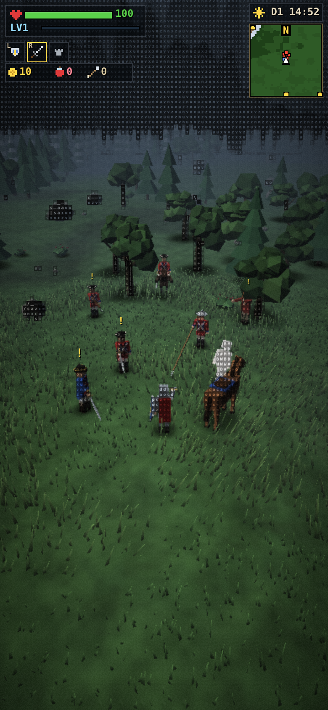
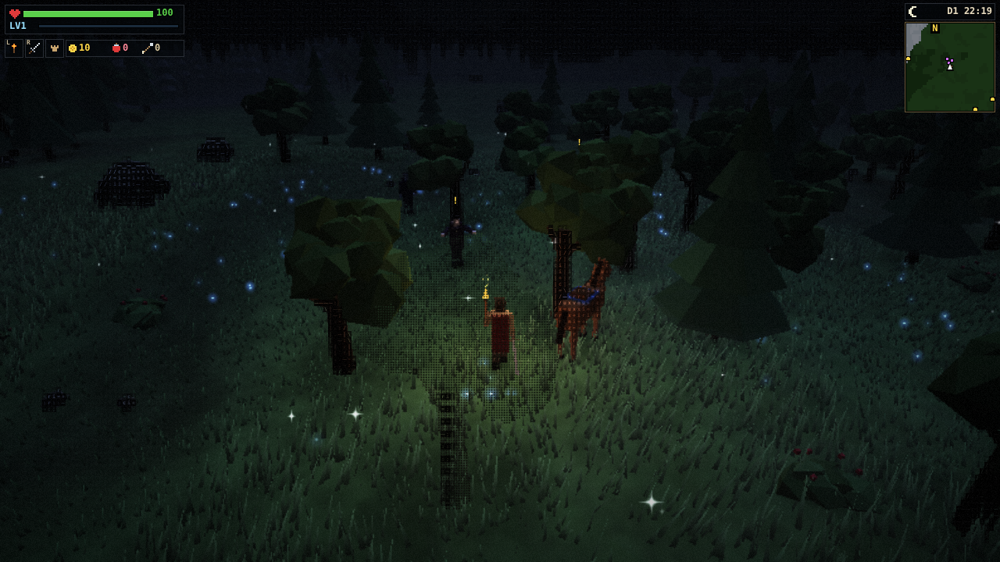
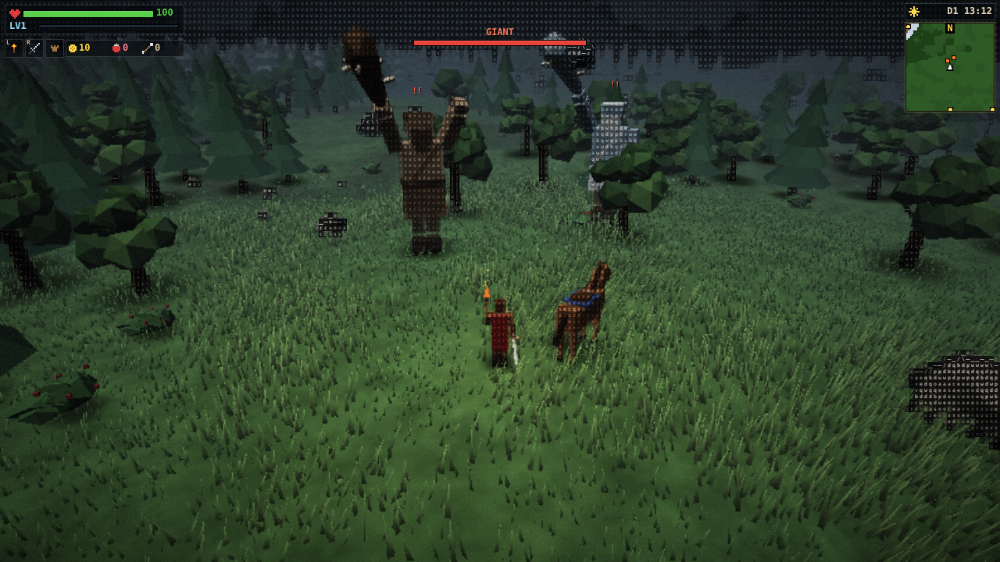
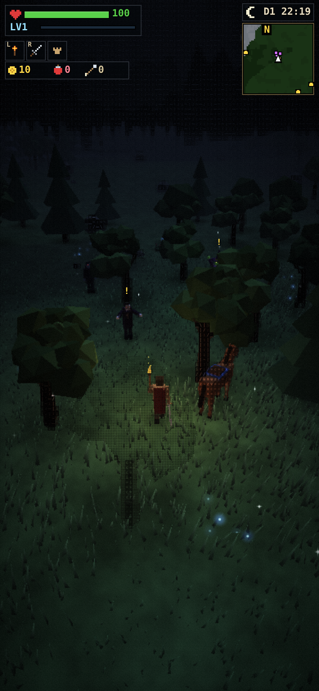

# Iron Crown 1700

A third-person, open-world RPG that runs in the browser. It is set in Anno Domini 1700: by day you fight the Usurper's redcoat armies, and at night vampires, witches and giants come out.

## Play

Open `index.html` in any modern browser with WebGL2. It is one self-contained file with no dependencies, and it works with a keyboard or a touchscreen.

## Features

- **Near-endless world.** The map is generated in chunks as you explore. It has six biomes: the Green Vales, the Old Forest, the Frostlands to the north (snow, frost giants), the Mirefen Swamps, the Grimmoor Heath (giants) and the Southern Sands to the south.
- **Villages and ruins.** Villages have a merchant, guards, a campfire you can rest at, a well and fields. Ruins hold treasure chests.
- **Day and night.** A full day takes 7 minutes. Without a torch, nights are dark. Every fifth night has a blood moon.
- **Unarmed start.** You begin in a linen tunic with no weapon. Your first fight is with your fists: landing 3 hits in a row gives a takedown.
- **Two hands.** Each hand holds one item:
  - swords (5 tiers)
  - shields that block attacks from the front (buckler, kite, tower)
  - a torch, which gives light and burns undead
  - a flintlock pistol

  Two-handed items take both hands: the claymore, and bows (hold to draw; they need arrows).
- **Armor tiers.** Tunic, gambeson, leather, chainmail, half-plate, full plate. Heavier armor protects more but slows you down.
- **Horse riding.** Mount and dismount, or whistle to call your horse. A charge does extra damage and tramples enemies. Pikemen deal double damage to riders, and a giant's slam knocks you off.
- **Enemies.**
  - By day: bandits, soldiers, pikemen, musketeers, archers, and dragoons (cavalry). There are also battles where the Royal army fights redcoats.
  - At night: vampires (they drain health and teleport behind you) and witches (homing fireballs, teleporting).
  - Giants and frost giants (ground slams, boulders).
- **RPG systems.** XP and levels, an inventory (20 slots), buying and selling with merchants, and loot that gets better the further you travel. The game saves when you rest at a campfire and also autosaves.

## Controls

| Action | Keyboard | Touch |
|---|---|---|
| Move / turn | W S / A D (or arrows) | Left-side joystick |
| Right hand | J, Space, left click | RIGHT |
| Left hand (hold to block) | K, Q, right click | LEFT |
| Trade / rest / loot / mount | E | USE |
| Horse (mount, dismount, call) | H | HORSE |
| Potion | R | POT |
| Inventory | I, Tab, B | BAG |
| Pause / mute | P, Esc / M | II |

## Graphics

The world is a real-time 3D scene in raw **WebGL2** (no libraries), turned into text by an **ASCII post-process** in the spirit of Acerola's ASCII shader. The look follows the reference shots in `docs/reference/`: moody, dark and misty, with rocks and buildings drawn as dark shapes full of small letters, and painterly grass.

- **Scene.** Gentle fbm hills (gameplay stays 2D; height is visual only). Each chunk gets a terrain mesh coloured by tile, plus animated water. Trees, rocks, houses with chimneys and glowing windows, ruins, wells, campfires and chests are low-poly meshes drawn instanced per chunk, with distance LODs. A ring of distant mountains gives the horizon.
- **Characters.** Articulated low-poly rigs (head, torso, arms, legs, hat or helmet, cape, held items), animated in code: walk and gallop cycles, sword and fist swings, raised shield, bow draw, flinch, knock-down. The armour tier changes both colours and silhouette. The roster covers the horse, dragoon, vampire, witch on her broom, giant and frost giant, plus blob shadows.
- **Grass.** Tens of thousands of wind-swept blades around you (fewer on phones), coloured by the ground they grow on.
- **Atmosphere.** Sun or moon light by time of day, point lights for your torch, campfires, windows, fireballs and burning foes, and distance + height fog by biome. A sky with stars and moon glow, ground mist over water and swamps, snowfall, embers, chimney smoke, sparkles and blue fireflies at night.
- **ASCII pass.** The scene renders at reduced resolution. Every material writes an "ASCII amount" into alpha: about 1 for terrain, rock and buildings, 0.6 for characters, 0.3 for grass and foliage, and 0 for glows. The screen is then split into cells, about 6 CSS px on desktop and 4.5 on phones. Each cell averages its colour and picks a glyph by luminance from a runtime-generated atlas (` .:-=+ ... vzxnu eosac wpqdb ... @`), with per-cell letter variation. Depth edges become `| / \ _ -`. Glyphs are drawn in the boosted cell colour over a dark tint, mixed with the scene by the ASCII amount. Bloom, grain and a vignette finish the frame.
- **HUD.** A separate crisp 2D canvas on top with the same panels, minimap and world markers. Without WebGL2 the game shows a clear message instead.

| | |
|---|---|
|  |  |
|  |  |
|  |  |
|  |  |

## Project structure

```
src/1_core.js     utilities, palette, item + creature data
src/2_world.js    biomes, tiles, infinite chunk generation, villages, collisions
src/3_gl.js       WebGL2 core: shaders, camera, sun/moon + fog, point lights, ASCII post-process
src/3_mesh.js     low-poly mesh builder; rigged people, armour, items, horse, giants, scenery
src/3_scene.js    terrain chunks, instancing + LODs, grass, particles, mist, actors, frame, overlays
src/4_game.js     game state, player, two-hand combat, AI, events, day/night, saves
src/5_ui.js       HUD, minimap, input (keyboard / touch), overlays, sound, main loop
src/shell.html    page shell: CSS, overlays, touch controls
build.py          inlines src/*.js into shell.html -> index.html (and test/game.js)
test/harness.js   Node vm harness with DOM/canvas stubs
test/sim.js       scripted play-through on the harness (fights, biomes, death, saves)
test/scenes.py    Playwright screenshots (SwiftShader WebGL2) of test scenes -> shots/
```

To build, run `python3 build.py`. `index.html` is generated, so don't edit it by hand.
