# Iron Crown 1700

A third-person, open-world RPG that runs in the browser. It is set in Anno Domini 1700. The King is dead, his heir has vanished, and the Lord Protector wears the Iron Crown. By day his redcoats hold the roads; by night the old wards fail, and vampires, witches, giants, ghosts and gremlins come out.

## Story

King Edmund III died at Michaelmas, and that same night his daughter Elinor, heir to the Iron Crown, vanished. The Lord Protector, Ravensworth, took the Crown "until she is found". Since the Crown left its rightful line, the wards that kept the dark things down have been failing. You wake in Ashford with no memory of the sealed letter you were carrying. A hooded stranger at the inn has been asking for you.

A new game starts straight in Ashford with this prologue; there is no tutorial fight. The main story has eight chapters, and each one is placed on a real landmark of the generated world:

| # | Chapter | Where | What |
|---|---|---|---|
| 1 | A Stranger in Ashford | Ashford inn | Talk to the Stranger. He gives you a rusty sword and a torch. |
| 2 | Teeth in the Dark | the Old Mill, near Ashford | A gremlin pack stole his signet ring. Kill the carrier, pick up the ring, bring it back. He turns out to be Sir Aldous Grey, the Princess's guardian. |
| 3 | The Captain's Word | the neighbouring village (Sandby) | Show the ring to Captain Hale of the Royal army. |
| 4 | The House of Thorns | the nearest haunted manor | Destroy the vampire lord who rules it. You find Elinor's journal and take it to Hale. |
| 5 | The Paymaster's Road | the road to the Usurper's castle | Ambush Paymaster Crake (an elite dragoon) for the Protector's warrant. |
| 6 | Mother of the Mire | the swamps | Kill the witch Mother Gall, who was paid to bind the Princess's tongue. |
| 7 | The Frozen Warden | a ruined castle in the Frostlands | Defeat Hrimgar the Warden (an elite frost giant) and free Lady Elinor in the ruined keep. |
| 8 | The Iron Crown | the nearest Usurper stronghold | Defeat Lord Protector Ravensworth. The epilogue sees Elinor crowned in Ashford, and you play on. |

## Quests

- **Quest givers.** Innkeepers, priests, Royal captains (in some villages), the Stranger, and later Elinor. A gold **!** over an NPC (or over the door of the building they are in) means work is on offer; a **?** means you have something to report. Press **E** (touch: **USE**) to talk. The dialogue shows a few lines, then **Accept** / **Decline** for each offer; innkeepers also rent beds from it.
- **Side quests** are generated per village and giver from a seed, so the same village always offers the same jobs, and new ones appear when you finish them:
  - **Bounty**: kill N of a kind at a named place nearby.
  - **Stolen**: a gremlin pack took a relic. Kill the carrier and pick up what it drops.
  - **Rescue**: drive off the guards, free the captive, then walk them home (they follow you).
  - **The Master of …**: clear a haunted manor (priests).
  - **A letter for …**: carry a letter to a neighbouring village; you are paid on arrival.
  - **Wanted**: hunt a named elite (more HP, harder to stagger, boss bar, better loot).
- **Rewards**: gold, XP, gear rolled for the village's tier, and reputation. Each reputation point gives 3 % off in that village's shops, up to 15 %.
- **Quest log**: **Q** or the **QUESTS** button at the top of the screen. It shows chapters, steps with progress and distance, Track / Abandon, the story so far and your reputation. You can hold up to 5 side quests.
- **Tracking**: the tracked objective is shown under the health panel, as a gold diamond over the target when it is on screen, as an arrow at the screen edge when it is not, and as a diamond on the minimap rim.
- Quest state (active quests and their progress, the current chapter, finished quests, reputation, cleansed manors) is saved. Saves from before quests still load: they start the main story at chapter 1.

## Play

Open `index.html` in any modern browser with WebGL2. It is one self-contained file with no dependencies, and it works with a keyboard or a touchscreen.

## Features

- **Near-endless world.** The map is generated in chunks as you explore. It has six biomes: the Green Vales, the Old Forest, the Frostlands to the north (snow, frost giants), the Mirefen Swamps, the Grimmoor Heath (giants) and the Southern Sands to the south.
- **Villages you can walk into.** Every village is a ring of real buildings around a square: cottages, two-storey timber houses, a **tavern** (the innkeeper rents a bed: full heal, save, and a skip to dawn if it's night), a **blacksmith** with a glowing forge (weapons and armour), the **general store** (supplies, bows, light gear), often a **chapel** with a bell tower, and a barn by the fields. There are also fences, lamp posts, a well, and a campfire to rest at. Ruins in the wilds hold treasure chests.
- **Enterable buildings, no loading screens.** Walk through a door and the roof and upper walls dither away, the walls between you and the camera drop to knee height, and the camera eases in. Each interior is furnished: plank floors, tables and stools, beds, shelves, barrels and crates, a hearth that lights the room at night, a bar with kegs, pews and an altar, a forge and anvil. Windows glow after dark. Walls are solid (you can't walk, roll or ride through them, and arrows and musket balls stop on them); doors are gaps you walk through. Enemies find the door to come in after you.
- **Castles.** Rare landmarks, roughly one per 12×12-chunk region where the land allows (plains, heath or snow, no water, away from villages), each chosen deterministically from the region cell and named, e.g. *Dragonmoor Castle*. Each is about 70×70 units: 9.5-unit curtain walls with a crenellated wall-walk, round corner towers, square mid-wall towers, and a gatehouse with an open gate. The courtyard holds barracks, stables, a storehouse, a training yard with dummies and an archery target, a well and banners. A multi-storey keep has an enterable **great hall** with a long table, braziers, pillars, banners and a throne. There are three kinds:
  - **Usurper strongholds**: a redcoat garrison (scaled with danger) guards the walls, and the treasure chests are in the great hall.
  - **Royal castles**: friendly guards, and a **quartermaster** in the great hall selling gear two tiers above the local smith.
  - **Ruined castles** (snow and heath): broken walls and towers, rubble, and chests in the roofless keep. After dark, vampires and witches gather there.
  
  Entering a castle shows a banner with its name. The minimap marks castles on its rim (red usurper, blue royal, grey ruin; the nearest is drawn larger) and draws their walls once you're close.
- **Day and night.** A full day takes 7 minutes. Without a torch, nights are dark. Every fifth night has a blood moon.
- **Haunted manors.** Rare, derelict three-wing mansions inside walled, overgrown gardens, with graves, box tombs, weeping statues, dead trees, a dry fountain, a broken iron gate and low fog. You can walk in through the front door. The roof and upper storey cut away to show four furnished rooms: a hall (grand stair, chandelier, portraits, a grandfather clock), a dining room with a long table, a library, and a crypt with sarcophagi, coffins and stairs leading down. There are dusty floors, cobwebs and candles. Gremlins lurk in the garden, ghosts and a vampire walk the rooms, and the manor's master, a **vampire lord**, waits in the crypt with the treasure. Moonlight falls through the windows in cold shafts (dusty sunlight by day). Killing the master cleanses the house for good. Manors are placed deterministically, about one try per 10×10-chunk region, mostly in forest, swamp and heath, never near villages or castles. The minimap marks them in violet.
- **Roads.** Dirt tracks link each village to its nearest neighbours, and lanes run to castle gates and manor gates.
- **Gear.** Two hands, one item each: swords (5 tiers), shields, a torch, a flintlock pistol. The claymore and bows take both hands. Armor goes from a linen tunic to full plate; heavier armor protects more but slows you, shortens your dash and its i-frames, and slows stamina recovery.
- **Horse riding**, an XP/level system, a 20-slot inventory with a hotbar, merchants, loot that improves with distance, and saves (rest at a campfire or an inn, plus autosave). Looted chests stay looted.

## Hotbar, inventory and forging

**Hotbar.** A row of 8 slots sits at the bottom centre of the screen, Minecraft-style. Each slot shows a small 3D thumbnail of its item, a stack count, its upgrade level (`+2`) and a temper gem, plus a marker if the item is in your hand (`L`, `R`, `2H`). The selected slot is outlined in gold, and a short item-name label fades in above the bar.

- Select a slot with the **mouse wheel**, the **1-8** keys, or (on touch) by **tapping** the slot. **Swiping** sideways along the bar cycles through the slots, and **holding** the bar opens the bag.
- Selecting a slot equips its item, following the two-hand rules:
  - a one-hand sword or the pistol goes to the right (main) hand;
  - the claymore and bows take both hands;
  - a shield, or a torch, goes to the off hand when the main hand holds a one-hand weapon (a shield also stows a two-hander);
  - an **empty slot means bare fists** (everything but a shield is stowed);
  - armour on the hotbar is put on.
- **Potions and bandages**: selecting one keeps your weapon in hand and turns ATTACK into **DRINK**. ATTACK drinks one, and so does pressing the same number key (or tapping the selected slot) again. **R** / **POT** still drinks a potion at any time.
- New weapons, shields, torches and consumables fill free hotbar slots automatically. The layout is saved; saves from before the hotbar build it from your gear.
- On phones the bar spans the bottom strip. In portrait the joystick and buttons sit above it; in landscape it fits between them.

**Inventory** (**I** / **B** / **BAG**). It has three equipment slots (left hand, right hand, body), the 8-slot hotbar, a 20-slot bag grid, and the **materials pouch**. Materials never take bag slots. Every slot shows a thumbnail with a tier colour: common, sturdy (green), superior (blue), rare (violet) and legendary (gold).

- **Drag and drop** (mouse or touch) between the bag, the hotbar and the equipment slots:
  - drag a bag item onto the hotbar to bind it;
  - drag it onto a hand or the body to equip it;
  - drag a hand onto the bag to unequip;
  - drag between the hands to swap them;
  - drag a hotbar slot back to the bag to unbind it.
- Invalid drops (a sword on your body, for example) are refused.
- **Touch fallback**: tap an item, then tap where it should go.
- **Detail panel**: a big thumbnail, the name in its tier colour, and the item's stats, each compared with what you have equipped (green ▲ / red ▼). The actions are Equip L / Equip R / Wear / Use / Unequip / To hotbar / Off hotbar / Split stack / Drop.

**Item thumbnails.** Each item type is rendered once from its real game mesh, the same `buildItem` and loot meshes used in the world. The render goes through a small offscreen WebGL target with faceted two-band lighting, a 3/4 angle (long items are auto-aligned to the diagonal and rolled to show their widest face) and a dark outline. The results are cached as canvases and data URLs. The thumbnails are used in the hotbar, the hand slots, the inventory, shops, the forge, pickup messages, treasure and quest-reward banners, and quest offers. If WebGL is unavailable, a drawn glyph is used instead.

**Materials.** Each entry gives what it is used for, then where to get it:

| Material | Used for | Where to get it |
|---|---|---|
| Iron Ore | smelting steel, arrows, upgrades | mining iron ore outcrops; redcoats, brutes; merchants |
| Silver Nugget | silvering, high upgrades, fine work | silver veins (snow / heath); vampires, vampire lords, Ravensworth |
| Steel Ingot | blades, plate, upgrades | smelt 2 ore + 1 timber at a forge; soldiers, dragoons; merchants in bigger villages |
| Timber | shields, bows, arrows, torches | chopping trees, logs and stumps; archers, giants; merchants |
| Leather Hide | grips, leather armour, armour upgrades | bandits, dragoons, giants; merchants |
| Linen Cloth | gambesons, bandages, torches | bandits, soldiers, vampires; merchants |
| Healing Herb | healing draughts | hitting bushes; witches, shamans; merchants |
| Gremlin Scrap | pistols | every kind of gremlin |
| Frost Shard | frost tempering, the Blade of the Crown | frost giants |
| Ghost Essence | +5 upgrades, the Blade of the Crown | ghosts, vampires, witches, vampire lords |

Chests also hold 1–3 stacks of materials.

**Mining and chopping.** Any swing that hits no foe can hit the world. **Ore outcrops** are craggy rocks studded with rusty iron (or bright silver) nuggets. One stands just outside every village, and more are scattered across the wilds, richest on the heath and in the Frostlands. Every couple of hits gives one ore; a claymore or a heavy swing mines faster, and fists mine slower. After 3–4 ore the vein is spent, and it shows ore again two days later (this is saved). **Trees**, logs and stumps give a few pieces of timber, and bushes sometimes give a healing herb.

**The blacksmith's forge.** Talk to any village blacksmith (**E** / **SMITH**). The forge screen has five tabs, and **Trade** opens the smith's shop (the shop has a **Forge** button back):

- **Craft**: weapons, shields and armour from recipes. Each row shows the required materials against what you own, with thumbnails, and greys out what you can't make yet.
- **Upgrade**: takes gear from **+1 to +5**. Each level adds about 8 % damage + 1 (weapons), +3 % block (shields) or +2.5 % armour (armour). The cost is iron, then steel, then silver at +4 and ghost essence at +5, plus gold.
- **Temper**: two kinds:
  - **Silvered** (2 silver): ×1.5 damage against the undead, ghosts and witches;
  - **Frost-tempered** (2 frost shards): +10 % damage, and struck foes are chilled (slowed).
- **Salvage**: breaks bag items down into about half their materials, more for upgraded or tempered gear.
- **Orders**: the smith's own side quest. Bring him a set of materials; the reward is gold, XP, reputation and a *Fine* piece of gear. A **?** shows over him when you can deliver.

| Smith recipe | Materials |
|---|---|
| Steel Ingot (smelting, no minigame) | 2 iron ore, 1 timber |
| Iron Sword | 3 iron ore, 1 timber, 1 hide, $8 |
| Steel Arming Sword | 3 steel, 1 hide, $20 |
| Knight's Longsword | 5 steel, 1 silver, 2 hide, $60 |
| Claymore | 6 steel, 2 timber, 1 hide, $45 |
| Blade of the Crown | 6 steel, 3 silver, 2 frost shards, 2 ghost essence, $150 |
| Flintlock Pistol | 3 steel, 2 timber, 3 gremlin scrap, $40 |
| Buckler / Kite / Tower Shield | 3 timber + 1 ore / 3 timber + 2 steel + 1 hide / 4 timber + 4 steel + 2 hide |
| Gambeson / Leather / Chainmail / Half-Plate / Full Plate | 4 cloth / 4 hide + 1 cloth / 4 steel + 2 ore + 2 cloth / 6 steel + 2 hide / 9 steel + 2 silver + 3 hide |

**Campfire workbench.** Use a village campfire (**E** / **CAMP**). You can **Rest** there as before, or craft:

- 10 arrows (1 timber + 1 iron ore);
- a torch (timber + cloth);
- 2 bandages (2 cloth, heal 25);
- a healing draught (3 herbs);
- short bow, longbow and war bow.

**The hammer minigame.** Forging, upgrading and tempering are done with three hammer strikes. A marker sweeps back and forth across a glowing bar, faster on each strike, and a bright mark sits in a new place each time. Strike with **Space / J / Enter**, a click, or the **STRIKE** button (touch). Each strike is graded and rings the anvil:

- **PERFECT** (within 4.5 % of the bar): 1;
- **GOOD** (within 12 %): 0.6;
- **FAIR** (within 22 %): 0.3;
- **MISS**: 0.

An average of 0.85 or more makes a **Masterwork** item (+10 % damage, or more block / armour), and 0.5 or more makes a **Fine** one (+5 %). Upgrading or tempering can raise an item's quality, but never lowers it. Materials are only used when the work is finished; **Stop** or Esc cancels.

**Under the hood.** Forged variants live in the item id string, `base[+level][!temper][#quality]` (for example `steel_sword+3!s#2`). `ITEMS` is a Proxy that resolves such ids into derived items on demand, so hands, the bag, the hotbar, shops and saves keep using plain strings, and old saves load unchanged.

| | |
|---|---|
| 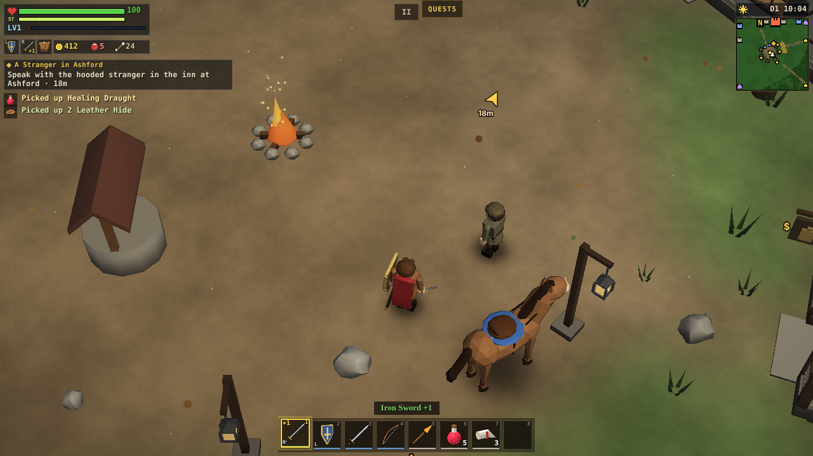 | 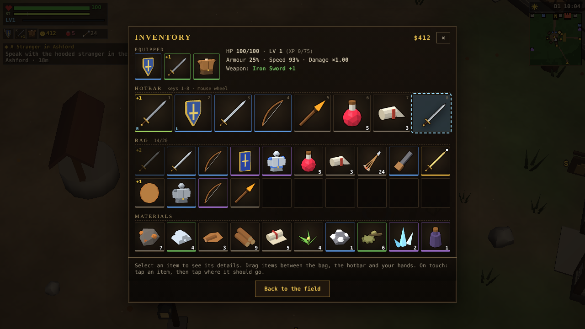 |
| 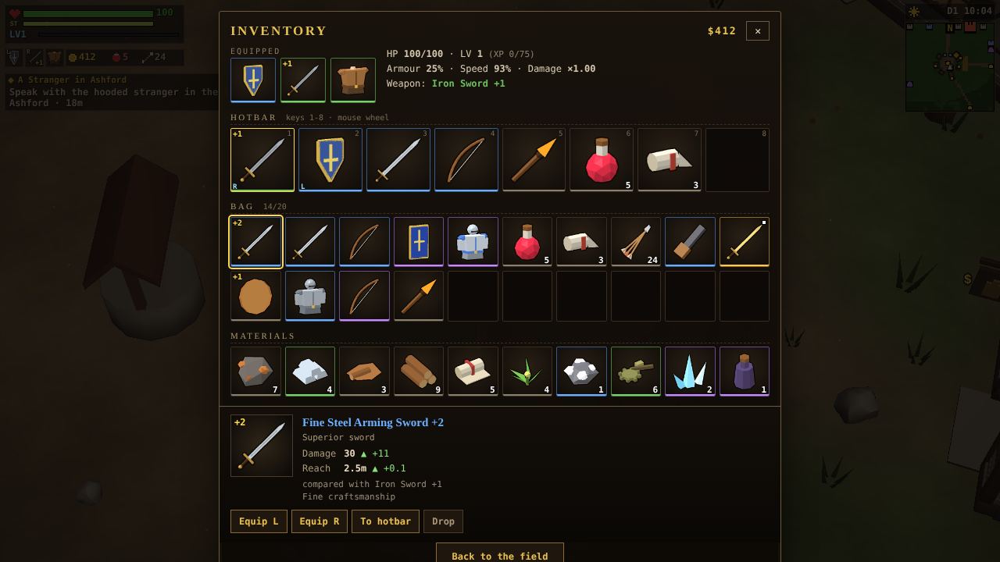 | 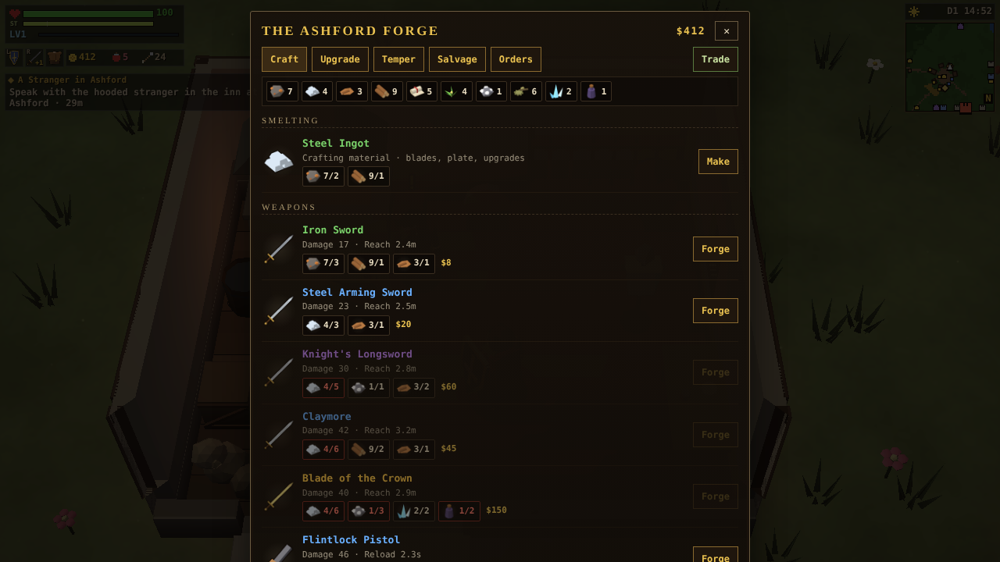 |
| 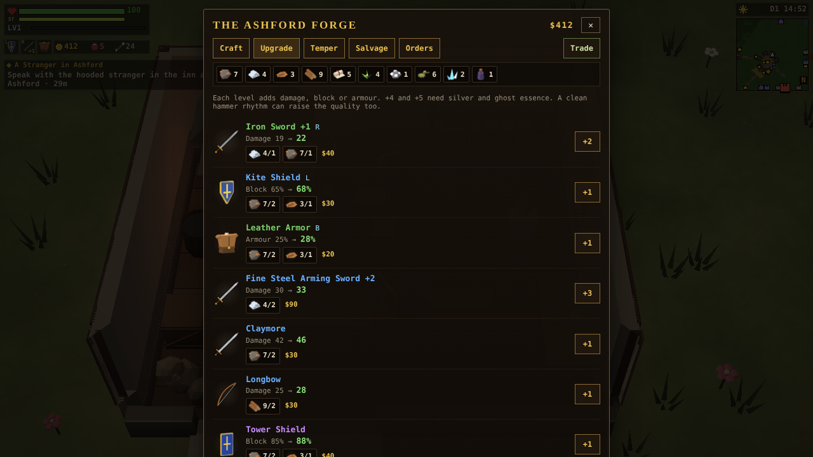 | 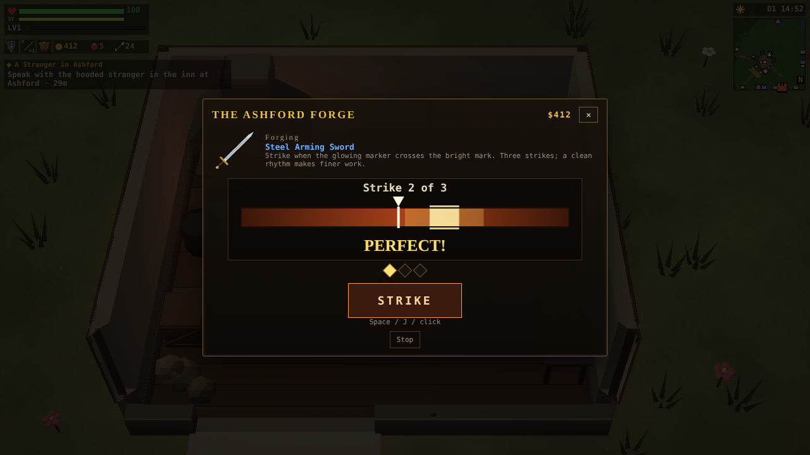 |
| 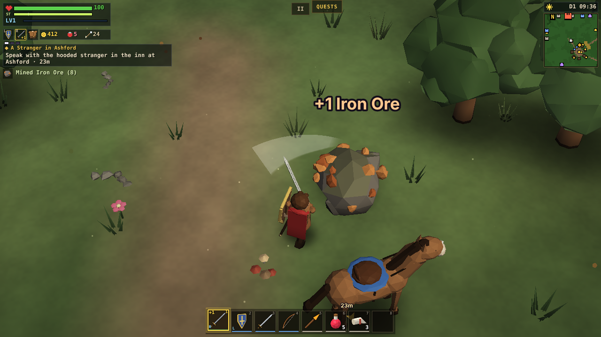 | 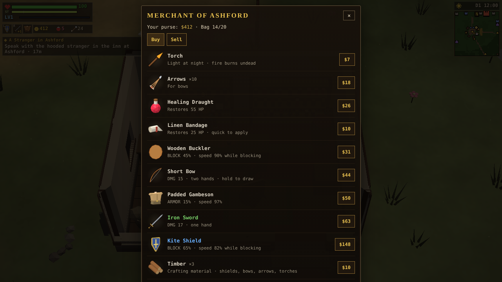 |
| 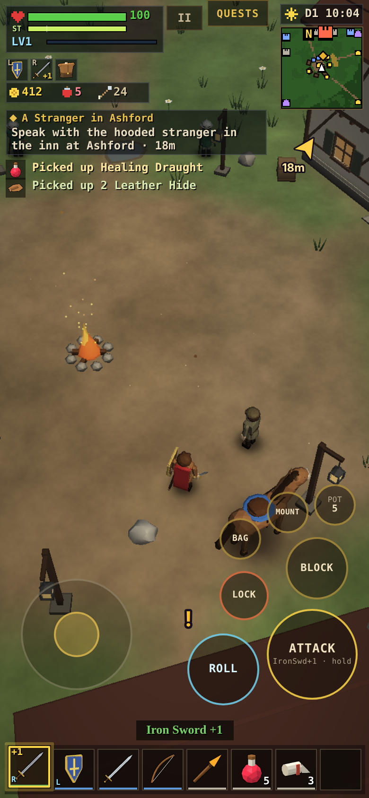 | 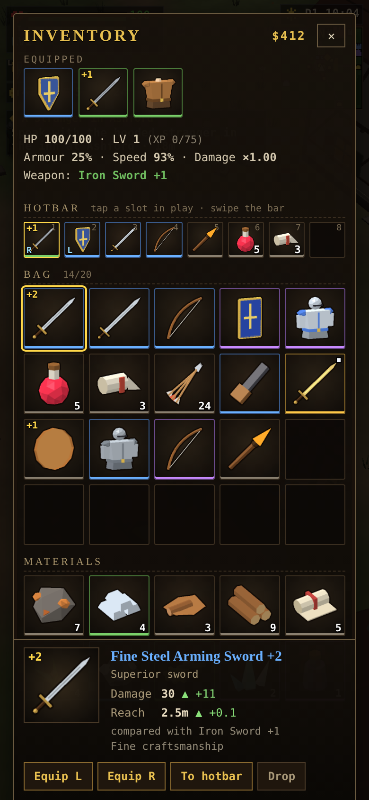 |

All inventory and forge scenes, at 1280×720 and 390×844: `docs/screenshots/grid_inventory.png`.

## Combat

Combat is built around timing. Every attack, yours and the enemy's, has wind-up, active and recovery frames, and every enemy attack is telegraphed.

**Reading enemies.** Before an enemy strikes, it flashes and paints its hitbox on the ground. A **yellow** flash and decal can be parried or blocked. A **red** one cannot: dodge it. The decal fills up as the wind-up runs out, so you can see exactly when the hit lands.

| Enemy | Attack | Tell |
|---|---|---|
| Bandit | Punch (0.5 s wind-up) | yellow sector |
| Soldier | 3-hit combo; the last hit is delayed (0.72 s), plus a single cut | yellow sector |
| Pikeman | Lunging line thrust, 3.9 units (0.62 s) | red line |
| Musketeer | Aims with a red line, locks 0.32 s before firing; fixed 1.05 s delay | red aim line |
| Archer | Lighter version: 0.85 s aim, arrows can be parried | yellow aim line |
| Dragoon | Gallop charge along a line (0.62 s wind-up, 15 units) | red line |
| Vampire | Dash-in lunge (yellow), drain grab (red), claw swipe; blinks behind you when hit | yellow / red |
| Witch | Homing fireballs (parry to send them back), ground blast circle (1.0 s) | yellow / red circle |
| Giant / frost giant | Slam with an expanding circle (1.1 s), club sweep (yellow), boulder throw onto a target circle | red / yellow |
| Gremlin scrapper | Darts in for a quick claw, then backs off. **Snatch**: if it lands, it steals 20 % of your purse and runs, giggling, with a **$** over its head; kill it and it drops every coin. If you don't catch it within ~16 s it escapes with the gold. Near a mounted rider it **shrieks** to spook your horse. | yellow / red circle |
| Firebomb gremlin | Keeps its distance and lobs a fizzing bomb onto a target circle | red circle |
| Gremlin shaman | Chants for 1.4 s to heal its pack and send them into a frenzy (faster, harder hits, green glow). Any hit interrupts the chant. Also throws homing hexes, which you can parry back. | yellow |
| Gremlin brute (mini-boss) | Slam (red circle), club sweep (yellow), charge (red line) | red / yellow |
| Ghost | Translucent, and drifts straight through walls. Chilling touch (yellow, slows you); wail (red circle) | yellow / red |
| Vampire lord (boss) | Vampire moves plus a blood nova | yellow / red |
| Lord Protector Ravensworth (final boss) | 3-hit sabre combo, lunging thrust (red line), war-cry shockwave | yellow / red |

Gremlins come in packs of 3–6, mostly at night (and more often near haunted manors), and they giggle. Ghosts haunt the night and the manors. Torches and fire do ×2.3 damage to ghosts and vampires.

Only one or two enemies (two on harder ground) may wind up a melee attack on you at the same time; the rest circle and wait for an **attack token**. Ranged enemies share their own two tokens.

**Forward roll.** 0.4 s long with **i-frames for the first 0.24 s**, costs stamina, and cannot be done below 18 stamina, so spamming it runs you dry. It cancels the recovery of your attacks, a heavy charge or a bow draw, but never a wind-up. If an attack would have hit you during the i-frames, it's a **PERFECT DODGE**: 0.45 s of slow-motion (the world runs at 30 %), a flash, +25 stamina, and a 1.4 s counter window where your next hit is a guaranteed x2 crit.

**Light combos.** Tap attack in rhythm. A white glint marks the moment the next swing opens (at the end of each swing's active frames); press again inside it to chain, up to 0.14 s after the swing ends. Pressing more than 0.14 s before the window opens ("too early", i.e. mashing during the wind-up) drops the string. Pressing in the first 0.1 s of the window is a sharp hit (+15 % damage). Finishers stagger.

| Weapon | String | Notes |
|---|---|---|
| Fists | jab, cross, hook | the hook knocks foes down (TAKEDOWN) |
| Sword | slash, back-slash, thrust | the thrust reaches further |
| Claymore | sweep, sweep | wide arcs, slow wind-up |
| Torch | 2 swings | sets targets burning (x2.3 vs undead) |
| Mounted | side sweep | toward the nearest foe beside the horse |

**Heavy attack.** Hold attack for 0.26 s to start charging. A ring shrinks around you; releasing when it turns gold (a 0.16 s window after full charge) is a **CRUSH**: x2.6 damage, a big poise hit and a guard break. Releasing early does up to x1.6; holding too long falls back to x1.6.

**Block and parry.** Hold block with a shield to block from the front; it drains stamina and breaks when stamina runs out. Tap it just before a yellow hit lands to **PARRY**: the attacker staggers and your next hit is a x2.6 **RIPOSTE**. Windows: shield 0.16 s, sword 0.1 s, bare hands 0.12 s. A bare-handed parry becomes a **grab and throw**. Parrying a fireball or an arrow reflects it back at the shooter. After a parry attempt there's a 0.42 s cooldown, so mashing doesn't work.

**Ranged.** Bows draw while you move slowly; releasing in the 0.14 s perfect window gives a crit arrow that pierces. They use arrows. The pistol has a 2.3 s reload, and a shot that lands during an enemy's wind-up or aim **interrupts** it. The torch lights the area at night.

**Poise and hit feel.** Every enemy has poise (the yellow line under its health). Hits wear it down; at zero they stagger, and giants are **BROKEN** for 2.6 s. Hits have 50–120 ms of hitstop, screen shake, sparks and knockback. Early hits interrupt a wind-up. Soft aim assist turns your swings toward the nearest foe in front of you. **Lock-on** cycles through targets, draws a reticle and pulls the camera toward the target.

**Mounted.** The horse sprints on stamina (dash = burst), side sweeps hit what you ride past, and charges trample. Hard hits (slams, charges, big damage) throw you off.

**STYLE rank (D → C → B → A → S).** It rises with combos, sharp hits, perfect dodges, parries and interrupts, drops when you are hit, and decays when you stop. It multiplies XP and gold (x1.0 to x1.6).

**Input buffer.** Attack, dash and block presses are remembered for 0.14 s, so a press slightly early still counts.

There is no tutorial fight. The controls are listed on the title screen and the pause screen, and enemy wind-ups read the same everywhere (yellow = parry, red = dodge).

## Controls

| Action | Keyboard / mouse | Touch |
|---|---|---|
| Move (camera-relative) | WASD or arrows | left-side joystick |
| Forward roll | Space or Shift | ROLL |
| Attack (tap = combo, hold = heavy; draw bow, fire pistol) | J or left click | ATTACK |
| Block / parry / off-hand | K or right click | BLOCK / PARRY |
| Quest log | Q | QUESTS (top of screen) |
| Lock on (press again for the next target) | L or Tab | LOCK |
| Turn camera 45° | Z / X | – |
| Talk (quest givers, innkeeper: quests, bed) / trade (merchant, quartermaster) / forge (blacksmith) / campfire (rest, craft) / loot / mount | E | USE |
| Hotbar: select a slot | 1-8, mouse wheel, click a slot | tap a slot, swipe the bar |
| Hit ore rocks / trees for materials | attack | ATTACK |
| Forge hammer strike | Space, J, Enter or click | STRIKE |
| Enter a building | walk through the door | joystick |
| Horse (mount, dismount, call) | H | HORSE |
| Potion (or a potion selected on the hotbar + attack) | R | POT (or DRINK) |
| Inventory (drag and drop) | I or B | BAG, or hold the hotbar |
| Pause / mute | P or Esc / M | II |

With a mouse, attacks aim at the cursor while you are using the mouse.

## Buildings and castles

**Finding a castle.** From Ashford, the nearest castle is **Dragonmoor Castle**, a Usurper stronghold about **240 units north-north-east** (around world position x 126, y −199, on the Grimmoor Heath). Leave Ashford by the road north and follow the red tower marker on the minimap rim. On horseback it's about half a minute. The garrison will come for you once you're inside the walls. The nearest royal castle, *Bleakmoor Castle*, is about 550 units north-east in the Frostlands, and *Ruins of Highhelm* is about 690 units north.

**Finding the first haunted manor.** From Ashford, the nearest one is **Weepingcote Manor** in the Old Forest, about **240 units west-south-west** (around x −199, y 114). It is the target of chapter 4, so once that chapter starts, the objective arrow points at it. Its gate faces west: go round the garden wall to the broken iron gate (a lane runs from it to the village of Marstead), cross the graveyard past the fountain, and enter through the portico. Go at night with a torch if you dare. Fire is what ghosts and vampires fear. The next manor, *Greystone Manor*, is on the Grimmoor Heath about 245 units east.

**How the cutaway works.** Every enterable building and castle area is a *structure*: an oriented footprint with doors. The structure you stand in drives a single cut volume in the mesh shader. Fragments of static geometry inside it (plus a small margin for eaves and chimneys) are discarded above the ground-floor height, using an ordered dither that fades in over 0.3 s. Walls whose outward side faces the camera are cut down to a 0.5-unit stub instead. Wall meshes are built as closed boxes split exactly at those heights, so a cut wall shows a clean top rather than a hollow shell. Characters are never cut. Inside a castle courtyard only the camera-side curtain wall drops (to 2.2 units). Inside a roofed building the sun and moon are dimmed a little and the hearth, lantern or brazier light is boosted, so interiors are lit by their fires at night.

**Collision.** Besides circle colliders, statics can be capsule wall segments or oriented boxes. Movement uses a swept test against the previous position, so fast rolls, lunges and gallops can't tunnel through thin walls. The same colliders block projectiles (by height) and melee lines of sight. Enemies path through doors and the castle gate with a small door-and-corner router plus smarter whiskers. Random encounter groups never spawn inside castle walls or buildings.

**Performance.** Village buildings are instanced per chunk like trees, with exterior-only far LODs. Each castle builds its parts once (one per frame, about 24k triangles in total), culls them per part, and swaps to a single ~2.8k-triangle silhouette at a distance. Castles far behind you are freed.

| | |
|---|---|
|  | 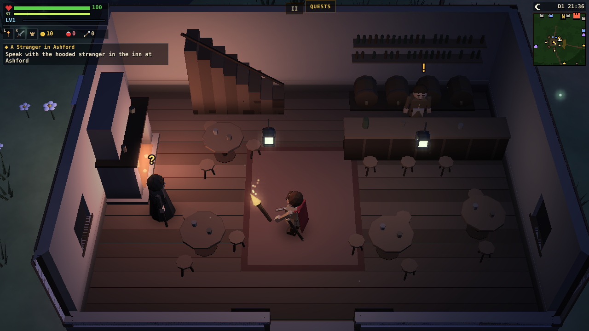 |
|  | 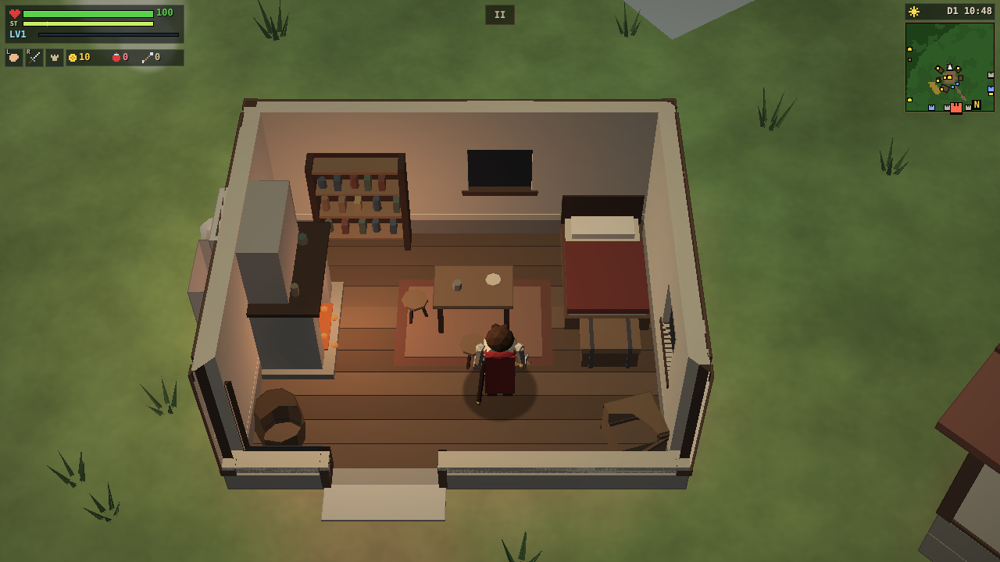 |
|  | 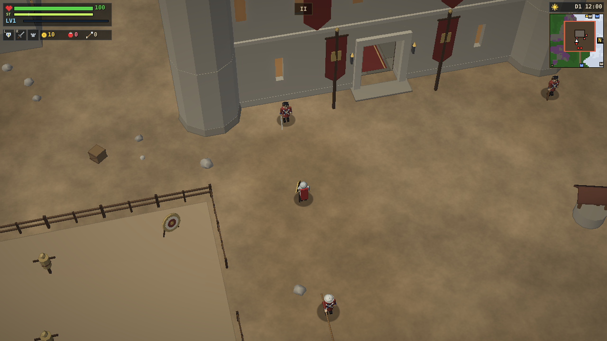 |
| 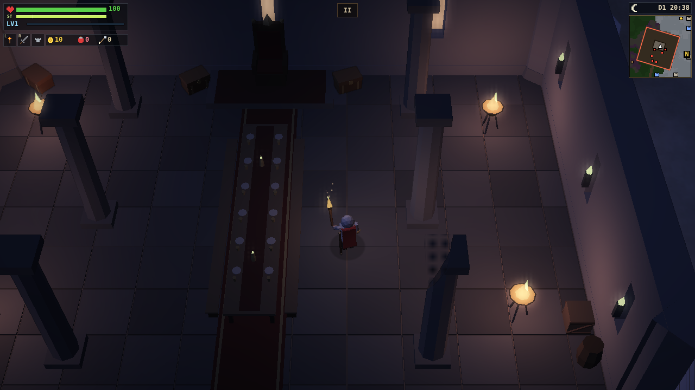 | 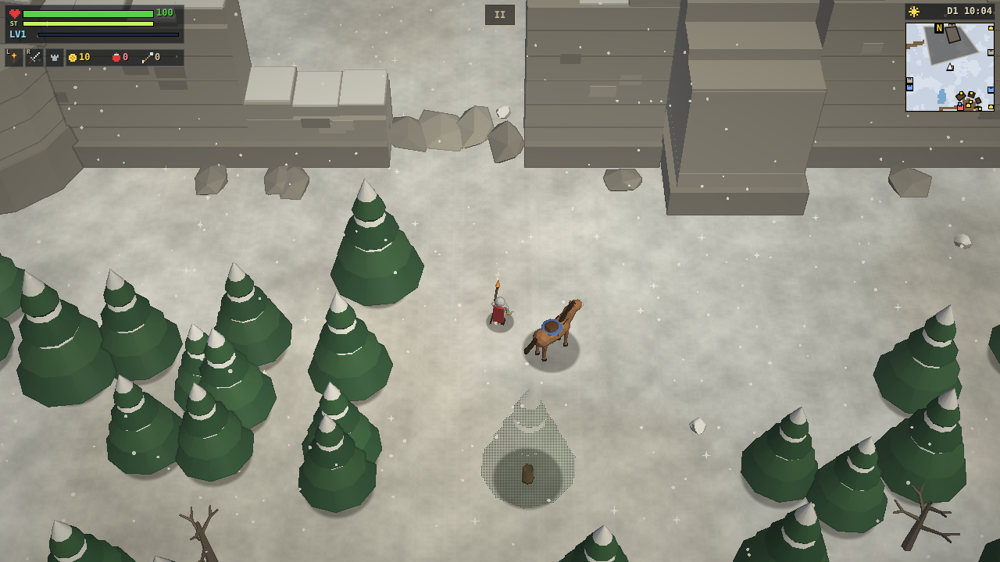 |
|  | 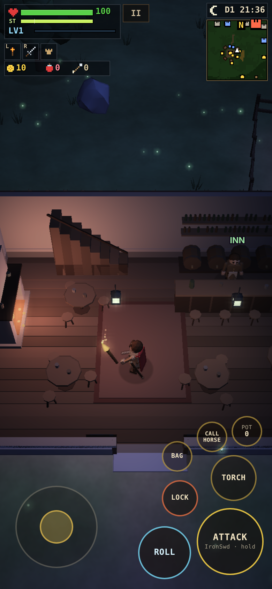 |

All building and castle scenes: `docs/screenshots/grid_buildings.png`.

## Story, gremlins and manors

| | |
|---|---|
| 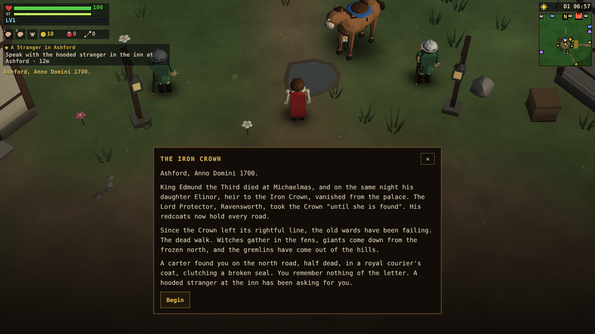 | 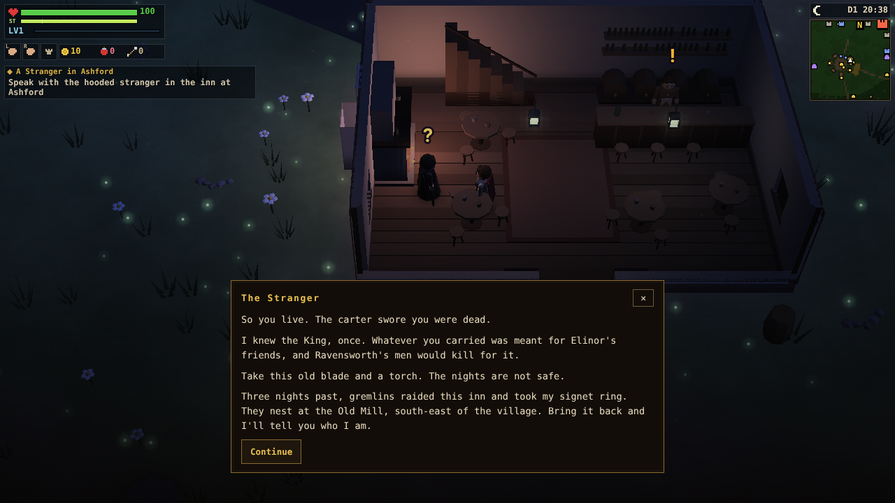 |
| 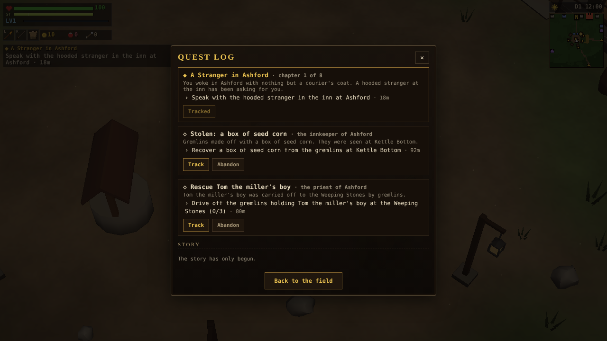 | 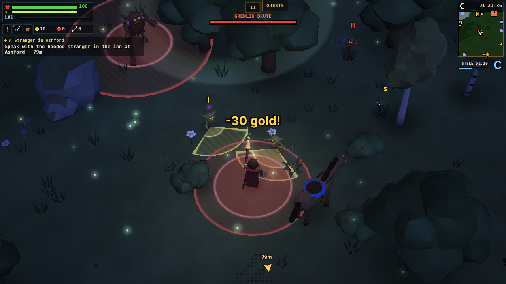 |
| 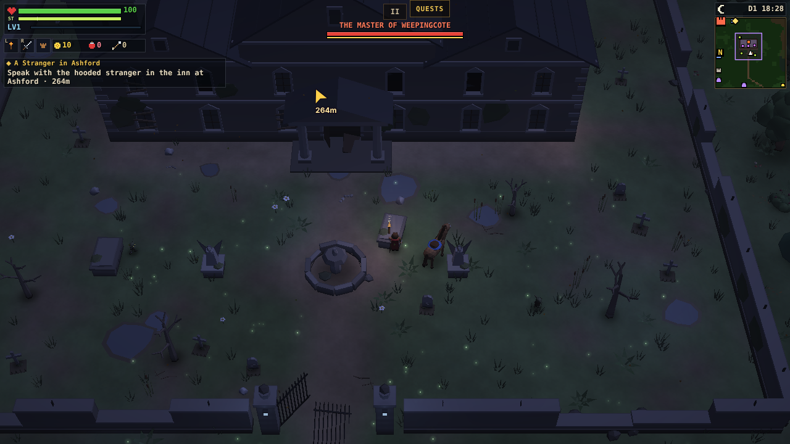 | 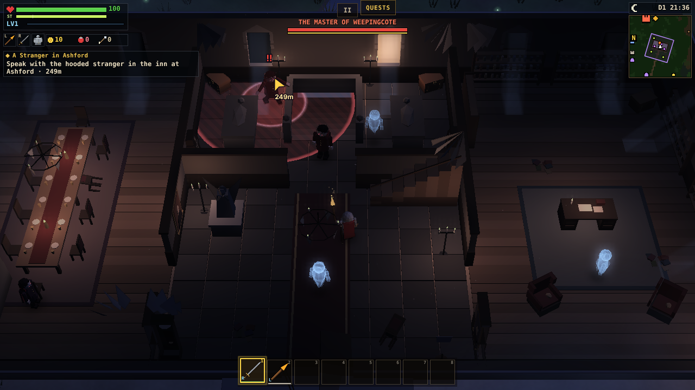 |
| 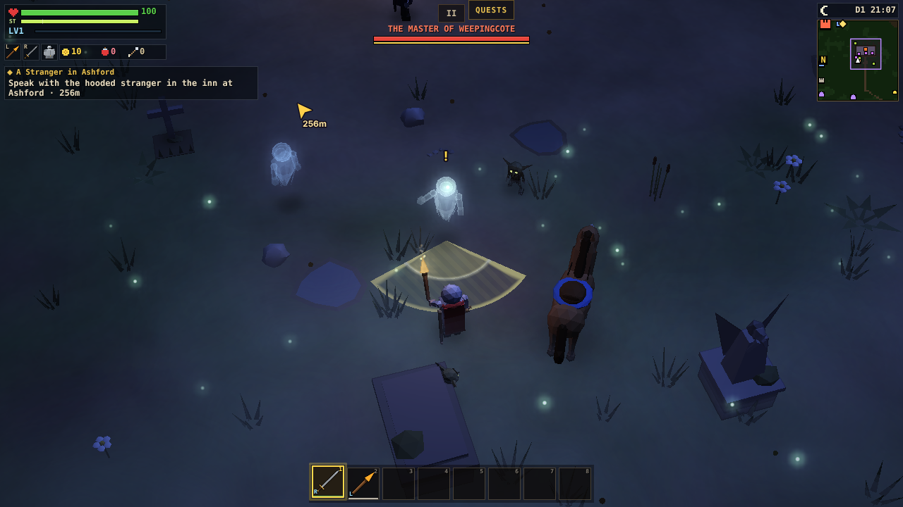 | 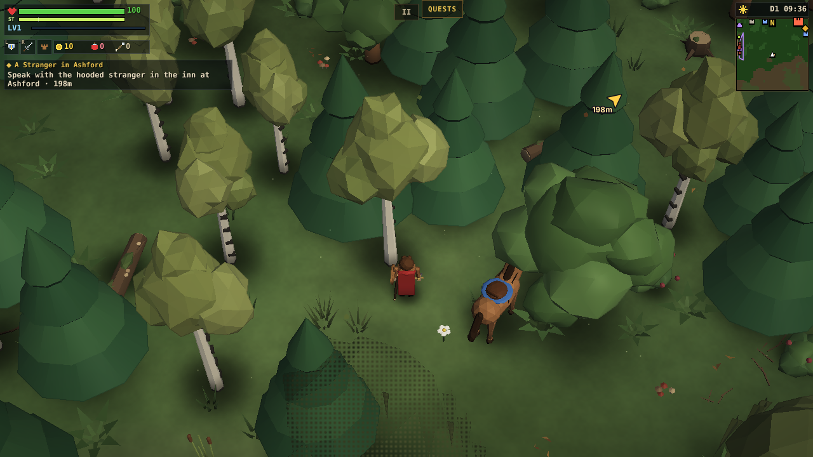 |
| 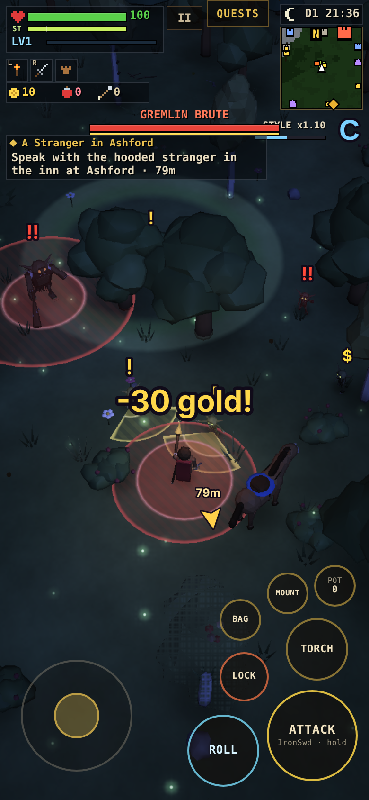 | 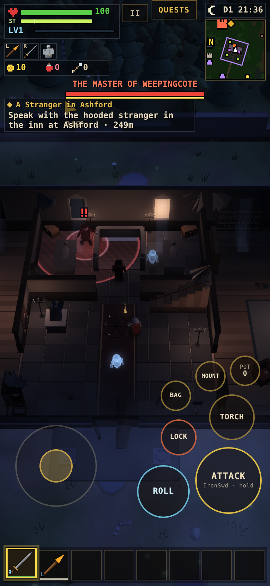 |

All story scenes: `docs/screenshots/grid_story.png`.

## Graphics

Low-poly, faceted 3D with a muted, earthy palette, soft wrapped lighting and thin, faint outlines, all in raw **WebGL2** with no libraries.

- **Toon shading.** A crisp two-band light ramp with a small highlight band, cool blue shadows, banded point lights (torch, campfires, windows, fireballs) and a soft rim light.
- **Outlines.** The scene renders to two targets: colour and an aux buffer holding a per-object id and an outline weight. A composite pass draws dark ink lines where the id or depth changes. Characters, trees, rocks and buildings get outlines; terrain, grass tufts and flowers don't.
- **Chibi models.** Big round heads (about a third of the height), painted eyes with highlights, blush, belts, trims, buttons and crests. Every character, the horse, the giants and the scenery were restyled.
- **World.** Bright, clean colour zones per biome, with no noisy grass blades: sparse tufts, flowers and reeds, toon water with foam bands, bright snow, warm sand. By day the palette is saturated; at night it turns dark blue, lit by warm torch and campfire light.
- **Camera.** A fixed 3/4 overhead view (50° pitch, perspective) with a gentle follow. It doesn't rotate with you, zooms out a little in combat and when riding, and leans toward a locked target.
- **Richer ground.** There are more tree species (birch, willow) and more deadfall (fallen logs, stumps, big mossy boulders). Each biome has its own scatter: ferns, mushrooms, leaf litter and twigs in the woods; grass clumps and wildflowers in the vales; reeds, cattails and puddles in the fens; heather and stones on the heath; snow tufts in the north. Decor is instanced per chunk and culled by distance.
- **Contact shading.** Vertical faces darken toward the ground they stand on: tree trunks, walls, rocks, furniture and legs. Shadow blobs are soft, with a dark core and a wide penumbra, pushed and stretched away from the sun.
- **Atmosphere.** There are layered banks of ground fog in the woods at dawn, dusk and night, thick mist over swamp water, and a heavy cold fog around haunted manors. Dust motes drift in the light by day and indoors, and leaves fall in the woods and vales.
- **Effects.** Solid slash ribbons, star-burst hit sparks, dust puffs, dash afterimages, parry flash rings, red/yellow ground telegraph decals, wind-up flashes on enemies, outlined damage numbers, bloom from emissive surfaces and FX, and slow-motion desaturation on perfect dodges.

| | |
|---|---|
|  |  |
|  | 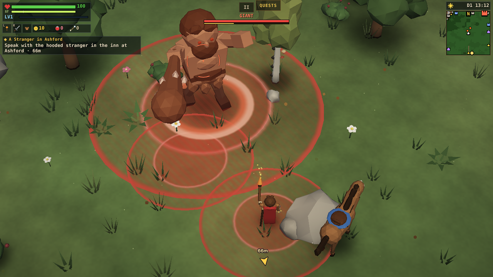 |
|  |  |
|  |  |
|  |  |

All test scenes: `docs/screenshots/grid_toon.png`.

## Project structure

```
src/1_core.js     utilities, palette, item + creature data
src/2_world.js    biomes, tiles, infinite chunk generation, villages, collisions
src/2_struct.js   wall / box colliders, structures (footprints, doors, navigation), building specs, village layouts, castle placement + plans
src/3_gl.js       WebGL2 core: toon shaders, outline + bloom composite, fixed 3/4 camera, sun/moon, lights
src/3_mesh.js     mesh builder; chibi rigged people, armour, items, horse, giants, toon scenery
src/3_thumb.js    item thumbnails: each item mesh rendered once offscreen (WebGL2) into cached canvases, glyph fallback
src/3_scene.js    terrain chunks, instancing + decor, poses, telegraph decals, slash ribbons, particles, frame, overlays
src/2_manor.js    haunted manors: deterministic placement, plan (rooms, furniture, garden, graves), colliders, structure, lights
src/3_arch.js     architecture kit: walls with doors and windows, roofs, furniture, interiors, village props, castle part meshes + LOD
src/3_manor.js    manor meshes (house, interiors, walled garden, gate), part LOD + culling, moonlight shafts
src/4_quest.js    the main story, side-quest generation, objectives, rewards, reputation, quest saves
src/4_game.js     game state, action combat (combos, dash, parry, heavy, poise, tokens, style), enemy AI, events, saves
src/4_craft.js    hotbar rules, materials, recipes, upgrades / tempering / salvage, the hammer minigame, mining and chopping
src/5_inv.js      HUD hotbar (wheel / keys / tap / swipe), inventory grid with drag and drop and item details, forge + campfire screens
src/5_ui.js       HUD, minimap, input (keyboard / touch), overlays, sound, main loop
src/shell.html    page shell: CSS, overlays, touch controls
build.py          inlines src/*.js into shell.html -> index.html (and test/game.js)
test/harness.js   Node vm harness with DOM/canvas stubs
test/sim.js       scripted play-through on the harness (story opening, chapter 2, fights, gremlins, a manor, biomes, tavern + inn, castle assault, ruins at night, death, saves)
test/story.js     story / quests / gremlins / ghosts / manors: no tutorial, quest accept → progress → reward, dialogue, saves (incl. old + corrupt saves), gold theft and recovery, horse spooking, shaman interrupt, bombs, ghosts through walls, manor determinism + cutaway, the whole main story
test/combat.js    timing tests: perfect dodge, parry windows, combo mashing, stamina, tokens, buffer
test/craft.js     hotbar rules, wheel + keys, inventory drag and drop, crafting, upgrades, tempering, salvage, forge timing + quality, mining, smith orders, hotbar saves + old saves
test/buildings.js wall collision, doors and gates, cutaway state, enemy navigation, castle placement, inn / smith / garrison, saves
test/scenes.py    Playwright screenshots (SwiftShader WebGL2) of test scenes -> shots/
```

To build, run `python3 build.py`. `index.html` is generated, so don't edit it by hand.
