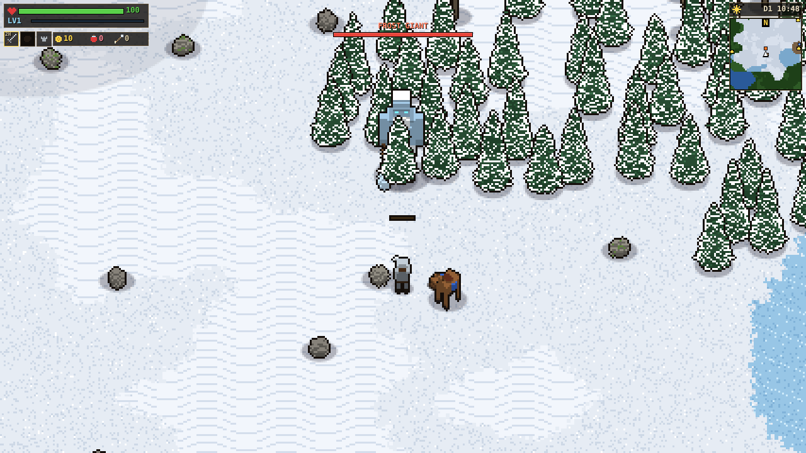
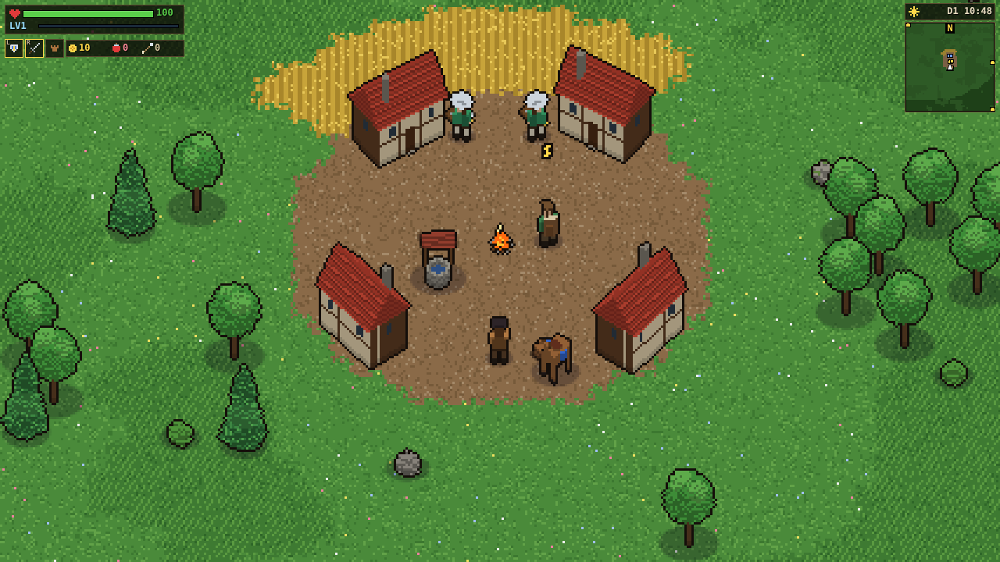

# Iron Crown 1700

A third-person, open-world RPG that runs in the browser. It is set in Anno Domini 1700: by day you fight the Usurper's redcoat armies, and at night vampires, witches and giants come out.

## Play

Open `index.html` in any modern browser. It is one self-contained file with no dependencies, and it works with a keyboard or a touchscreen.

## Features

- **Near-endless world.** The map is generated in chunks as you explore. It has six biomes: the Green Vales, the Old Forest, the Frostlands to the north (snow, frost giants), the Mirefen Swamps, the Grimmoor Heath (giants) and the Southern Sands to the south.
- **Villages and ruins.** Villages have a merchant, guards, a campfire you can rest at, a well and fields. Ruins hold treasure chests.
- **Day and night.** A full day takes 7 minutes. Without a torch, nights are dark. Every fifth night has a blood moon.
- **Unarmed start.** You begin in a linen tunic with no weapon. Your first fight is with your fists: landing 3 hits in a row gives a takedown.
- **Two hands.** Each hand holds one item:
  - swords (5 tiers)
  - shields that block attacks from the front (buckler, kite, tower)
  - a torch, which gives light and burns undead
  - a flintlock pistol

  Two-handed items take both hands: the claymore, and bows (hold to draw; they need arrows).
- **Armor tiers.** Tunic, gambeson, leather, chainmail, half-plate, full plate. Heavier armor protects more but slows you down.
- **Horse riding.** Mount and dismount, or whistle to call your horse. A charge does extra damage and tramples enemies. Pikemen deal double damage to riders, and a giant's slam knocks you off.
- **Enemies.**
  - By day: bandits, soldiers, pikemen, musketeers, archers, and dragoons (cavalry). There are also battles where the Royal army fights redcoats.
  - At night: vampires (they drain health and teleport behind you) and witches (homing fireballs, teleporting).
  - Giants and frost giants (ground slams, boulders).
- **RPG systems.** XP and levels, an inventory (20 slots), buying and selling with merchants, and loot that gets better the further you travel. The game saves when you rest at a campfire and also autosaves.

## Controls

| Action | Keyboard | Touch |
|---|---|---|
| Move / turn | W S / A D (or arrows) | Left-side joystick |
| Right hand | J, Space, left click | RIGHT |
| Left hand (hold to block) | K, Q, right click | LEFT |
| Trade / rest / loot / mount | E | USE |
| Horse (mount, dismount, call) | H | HORSE |
| Potion | R | POT |
| Inventory | I, Tab, B | BAG |
| Pause / mute | P, Esc / M | II |

## Graphics

The game uses **sprite-stacked pixel art** ([technique](https://www.spritecook.ai/blog/sprite-stacking-pixel-art)):

- **Models.** Each character, tree and building is a small voxel model built in code. It is cut into horizontal slices. Each slice is drawn rotated, squashed vertically to 0.75 and lifted 1 px above the one below it. The finished sprite gets an outline once and is cached per angle.
- **Camera.** Top-down and turning with you, so your heading always points up the screen.
- **Ground.** Pixel textures are pre-rendered for each 32×32 chunk.
- **Night.** A light map lets torches, campfires, windows and fireballs light up the dark.

| | |
|---|---|
|  |  |
|  |  |
|  |  |

## Project structure

```
src/1_core.js     utilities, palette, item + creature data
src/2_world.js    biomes, tiles, infinite chunk generation, villages, collisions
src/3_render.js   sprite-stacking renderer, voxel models, ground textures, lighting
src/4_game.js     game state, player, two-hand combat, AI, events, day/night, saves
src/5_ui.js       HUD, minimap, input (keyboard / touch), overlays, sound, main loop
src/shell.html    page shell: CSS, overlays, touch controls
build.py          inlines src/*.js into shell.html -> index.html (and test/game.js)
test/harness.js   Node vm harness with DOM/canvas stubs
test/scenes.py    Playwright screenshots of test scenes -> shots/
```

To build, run `python3 build.py`. `index.html` is generated, so don't edit it by hand.
