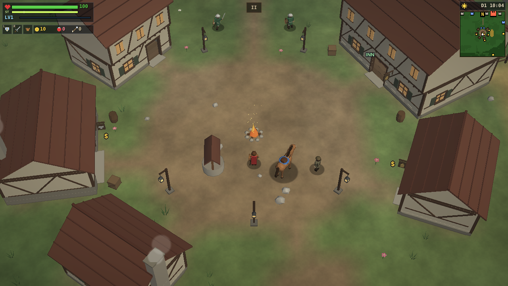
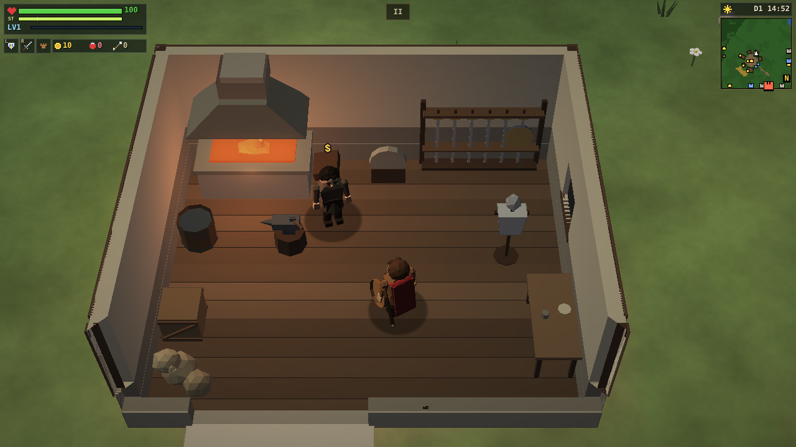
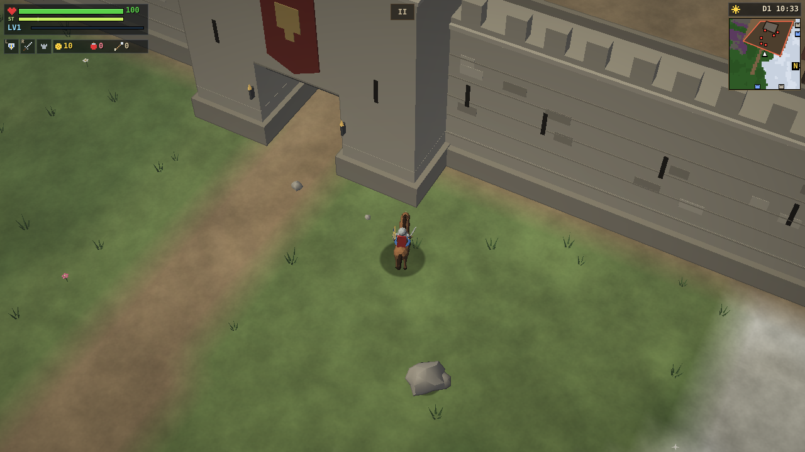
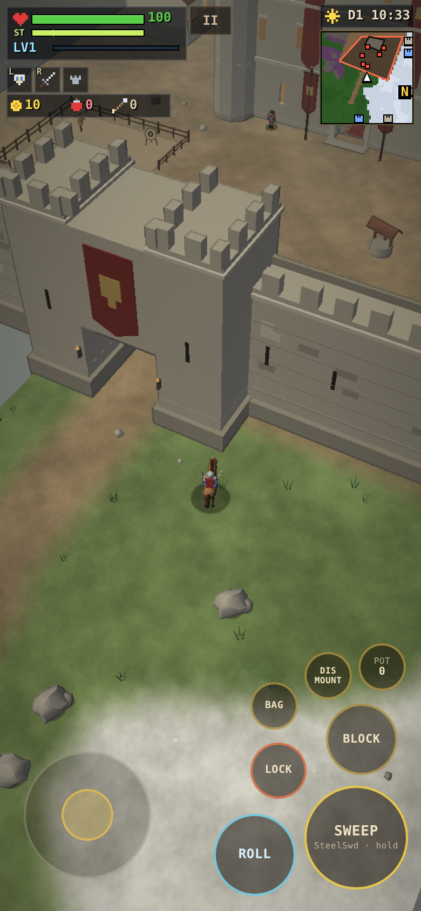
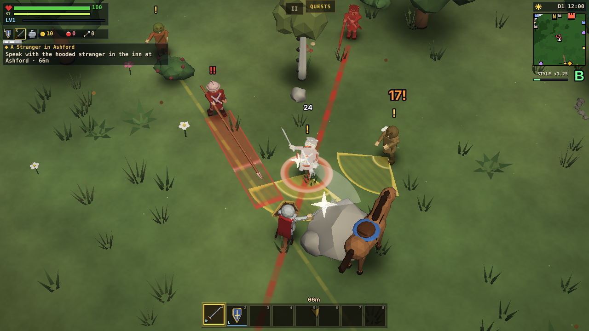
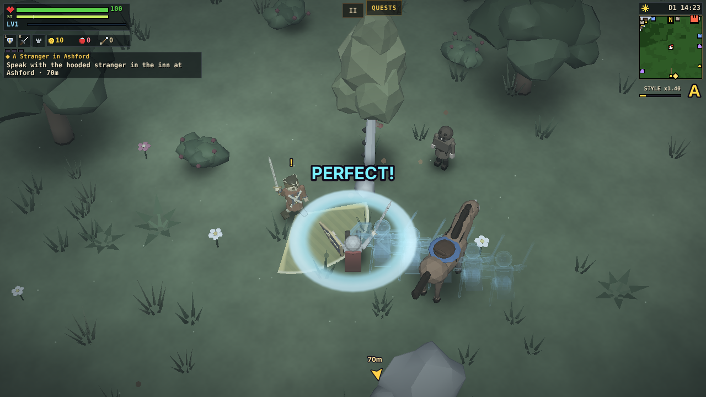
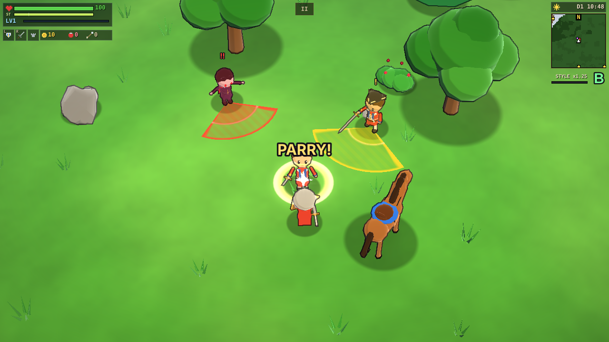
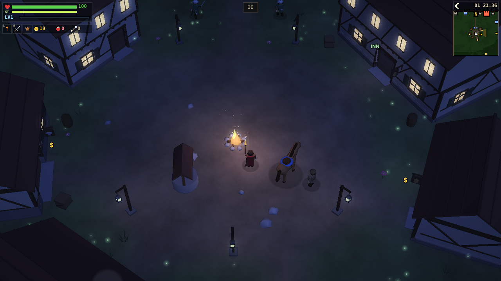
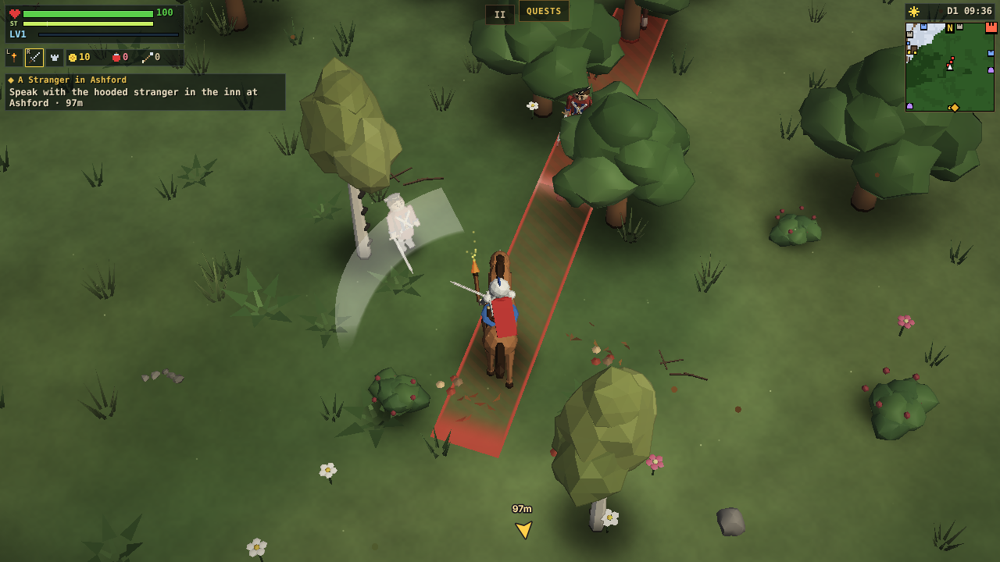
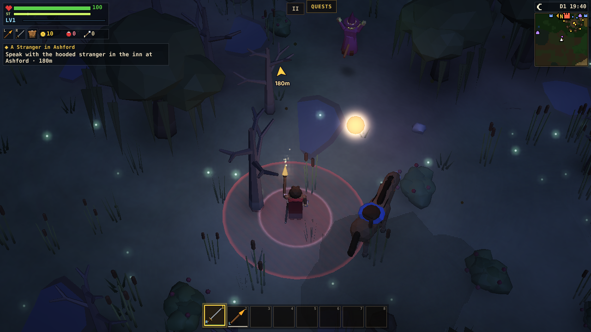

# Iron Crown 1700

A third-person, open-world RPG that runs in the browser. It is set in Anno Domini 1700: by day you fight the Usurper's redcoat armies, and at night vampires, witches and giants come out.

## Play

Open `index.html` in any modern browser with WebGL2. It is one self-contained file with no dependencies, and it works with a keyboard or a touchscreen.

## Features

- **Near-endless world.** The map is generated in chunks as you explore. It has six biomes: the Green Vales, the Old Forest, the Frostlands to the north (snow, frost giants), the Mirefen Swamps, the Grimmoor Heath (giants) and the Southern Sands to the south.
- **Villages you can walk into.** Every village is a ring of real buildings around a square: cottages, two-storey timber houses, a **tavern** (the innkeeper rents a bed: full heal, save, and a skip to dawn if it's night), a **blacksmith** with a glowing forge (weapons and armour), the **general store** (supplies, bows, light gear), often a **chapel** with a bell tower, and a barn by the fields. There are also fences, lamp posts, a well, and a campfire to rest at. Ruins in the wilds hold treasure chests.
- **Enterable buildings, no loading screens.** Walk through a door and the roof and upper walls dither away, the walls between you and the camera drop to knee height, and the camera eases in. Each interior is furnished: plank floors, tables and stools, beds, shelves, barrels and crates, a hearth that lights the room at night, a bar with kegs, pews and an altar, a forge and anvil. Windows glow after dark. Walls are solid (you can't walk, roll or ride through them, and arrows and musket balls stop on them); doors are gaps you walk through. Enemies find the door to come in after you.
- **Castles.** Rare landmarks, roughly one per 12×12-chunk region where the land allows (plains, heath or snow, no water, away from villages), each chosen deterministically from the region cell and named, e.g. *Dragonmoor Castle*. Each is about 70×70 units: 9.5-unit curtain walls with a crenellated wall-walk, round corner towers, square mid-wall towers, and a gatehouse with an open gate. The courtyard holds barracks, stables, a storehouse, a training yard with dummies and an archery target, a well and banners. A multi-storey keep has an enterable **great hall** with a long table, braziers, pillars, banners and a throne. There are three kinds:
  - **Usurper strongholds**: a redcoat garrison (scaled with danger) guards the walls, and the treasure chests are in the great hall.
  - **Royal castles**: friendly guards, and a **quartermaster** in the great hall selling gear two tiers above the local smith.
  - **Ruined castles** (snow and heath): broken walls and towers, rubble, and chests in the roofless keep. After dark, vampires and witches gather there.
  
  Entering a castle shows a banner with its name. The minimap marks castles on its rim (red usurper, blue royal, grey ruin; the nearest is drawn larger) and draws their walls once you're close.
- **Day and night.** A full day takes 7 minutes. Without a torch, nights are dark. Every fifth night has a blood moon.
- **Gear.** Two hands, one item each: swords (5 tiers), shields, a torch, a flintlock pistol. The claymore and bows take both hands. Armor goes from a linen tunic to full plate; heavier armor protects more but slows you, shortens your dash and its i-frames, and slows stamina recovery.
- **Horse riding**, an XP/level system, a 20-slot inventory, merchants, loot that improves with distance, and saves (rest at a campfire or an inn, plus autosave). Looted chests stay looted.

## Combat

Combat is built around timing. Every attack, yours and the enemy's, has wind-up, active and recovery frames, and every enemy attack is telegraphed.

**Reading enemies.** Before an enemy strikes, it flashes and paints its hitbox on the ground. A **yellow** flash and decal can be parried or blocked. A **red** one cannot: dodge it. The decal fills up as the wind-up runs out, so you can see exactly when the hit lands.

| Enemy | Attack | Tell |
|---|---|---|
| Bandit | Punch (0.5 s wind-up) | yellow sector |
| Soldier | 3-hit combo; the last hit is delayed (0.72 s), plus a single cut | yellow sector |
| Pikeman | Lunging line thrust, 3.9 units (0.62 s) | red line |
| Musketeer | Aims with a red line, locks 0.32 s before firing; fixed 1.05 s delay | red aim line |
| Archer | Lighter version: 0.85 s aim, arrows can be parried | yellow aim line |
| Dragoon | Gallop charge along a line (0.62 s wind-up, 15 units) | red line |
| Vampire | Dash-in lunge (yellow), drain grab (red), claw swipe; blinks behind you when hit | yellow / red |
| Witch | Homing fireballs (parry to send them back), ground blast circle (1.0 s) | yellow / red circle |
| Giant / frost giant | Slam with an expanding circle (1.1 s), club sweep (yellow), boulder throw onto a target circle | red / yellow |

Only one or two enemies (two on harder ground) may wind up a melee attack on you at the same time; the rest circle and wait for an **attack token**. Ranged enemies share their own two tokens.

**Forward roll.** 0.4 s long with **i-frames for the first 0.24 s**, costs stamina, and cannot be done below 18 stamina, so spamming it runs you dry. It cancels the recovery of your attacks, a heavy charge or a bow draw, but never a wind-up. If an attack would have hit you during the i-frames, it's a **PERFECT DODGE**: 0.45 s of slow-motion (the world runs at 30 %), a flash, +25 stamina, and a 1.4 s counter window where your next hit is a guaranteed x2 crit.

**Light combos.** Tap attack in rhythm. A white glint marks the moment the next swing opens (at the end of each swing's active frames); press again inside it to chain, up to 0.14 s after the swing ends. Pressing more than 0.14 s before the window opens ("too early", i.e. mashing during the wind-up) drops the string. Pressing in the first 0.1 s of the window is a sharp hit (+15 % damage). Finishers stagger.

| Weapon | String | Notes |
|---|---|---|
| Fists | jab, cross, hook | the hook knocks foes down (TAKEDOWN) |
| Sword | slash, back-slash, thrust | the thrust reaches further |
| Claymore | sweep, sweep | wide arcs, slow wind-up |
| Torch | 2 swings | sets targets burning (x2.3 vs undead) |
| Mounted | side sweep | toward the nearest foe beside the horse |

**Heavy attack.** Hold attack for 0.26 s to start charging. A ring shrinks around you; releasing when it turns gold (a 0.16 s window after full charge) is a **CRUSH**: x2.6 damage, a big poise hit and a guard break. Releasing early does up to x1.6; holding too long falls back to x1.6.

**Block and parry.** Hold block with a shield to block from the front; it drains stamina and breaks when stamina runs out. Tap it just before a yellow hit lands to **PARRY**: the attacker staggers and your next hit is a x2.6 **RIPOSTE**. Windows: shield 0.16 s, sword 0.1 s, bare hands 0.12 s. A bare-handed parry becomes a **grab and throw**. Parrying a fireball or an arrow reflects it back at the shooter. After a parry attempt there's a 0.42 s cooldown, so mashing doesn't work.

**Ranged.** Bows draw while you move slowly; releasing in the 0.14 s perfect window gives a crit arrow that pierces. They use arrows. The pistol has a 2.3 s reload, and a shot that lands during an enemy's wind-up or aim **interrupts** it. The torch lights the area at night.

**Poise and hit feel.** Every enemy has poise (the yellow line under its health). Hits wear it down; at zero they stagger, and giants are **BROKEN** for 2.6 s. Hits have 50–120 ms of hitstop, screen shake, sparks and knockback. Early hits interrupt a wind-up. Soft aim assist turns your swings toward the nearest foe in front of you. **Lock-on** cycles through targets, draws a reticle and pulls the camera toward the target.

**Mounted.** The horse sprints on stamina (dash = burst), side sweeps hit what you ride past, and charges trample. Hard hits (slams, charges, big damage) throw you off.

**STYLE rank (D → C → B → A → S).** It rises with combos, sharp hits, perfect dodges, parries and interrupts, drops when you are hit, and decays when you stop. It multiplies XP and gold (x1.0 to x1.6).

**Input buffer.** Attack, dash and block presses are remembered for 0.14 s, so a press slightly early still counts.

The opening bandit is a tutorial: land a 3-hit combo, parry-grab his punch, perfect-dodge it, then finish him.

## Controls

| Action | Keyboard / mouse | Touch |
|---|---|---|
| Move (camera-relative) | WASD or arrows | left-side joystick |
| Forward roll | Space or Shift | ROLL |
| Attack (tap = combo, hold = heavy; draw bow, fire pistol) | J or left click | ATTACK |
| Block / parry / off-hand | K or right click | BLOCK / PARRY |
| Lock on (press again for the next target) | L or Tab | LOCK |
| Turn camera 45° | Z / X | – |
| Trade (merchant, blacksmith, quartermaster) / rent a bed (innkeeper) / rest (campfire) / loot / mount | E | USE |
| Enter a building | walk through the door | joystick |
| Horse (mount, dismount, call) | H | HORSE |
| Potion | R | POT |
| Inventory | I or B | BAG |
| Pause / mute | P or Esc / M | II |

With a mouse, attacks aim at the cursor while you are using the mouse.

## Buildings and castles

**Finding a castle.** From Ashford, the nearest castle is **Dragonmoor Castle**, a Usurper stronghold about **240 units north-north-east** (around world position x 126, y −199, on the Grimmoor Heath). Leave Ashford by the road north, past the tutorial bandit, and follow the red tower marker on the minimap rim. On horseback it's about half a minute. The garrison will come for you once you're inside the walls. The nearest royal castle, *Bleakmoor Castle*, is about 550 units north-east in the Frostlands, and *Ruins of Highhelm* is about 690 units north.

**How the cutaway works.** Every enterable building and castle area is a *structure*: an oriented footprint with doors. The structure you stand in drives a single cut volume in the mesh shader. Fragments of static geometry inside it (plus a small margin for eaves and chimneys) are discarded above the ground-floor height, using an ordered dither that fades in over 0.3 s. Walls whose outward side faces the camera are cut down to a 0.5-unit stub instead. Wall meshes are built as closed boxes split exactly at those heights, so a cut wall shows a clean top rather than a hollow shell. Characters are never cut. Inside a castle courtyard only the camera-side curtain wall drops (to 2.2 units). Inside a roofed building the sun and moon are dimmed a little and the hearth, lantern or brazier light is boosted, so interiors are lit by their fires at night.

**Collision.** Besides circle colliders, statics can be capsule wall segments or oriented boxes. Movement uses a swept test against the previous position, so fast rolls, lunges and gallops can't tunnel through thin walls. The same colliders block projectiles (by height) and melee lines of sight. Enemies path through doors and the castle gate with a small door-and-corner router plus smarter whiskers. Random encounter groups never spawn inside castle walls or buildings.

**Performance.** Village buildings are instanced per chunk like trees, with exterior-only far LODs. Each castle builds its parts once (one per frame, about 24k triangles in total), culls them per part, and swaps to a single ~2.8k-triangle silhouette at a distance. Castles far behind you are freed.

| | |
|---|---|
|  |  |
|  |  |
|  |  |
|  |  |
|  |  |

All building and castle scenes: `docs/screenshots/grid_buildings.png`.

## Graphics

Low-poly, faceted 3D with a muted, earthy palette, soft wrapped lighting and thin, faint outlines, all in raw **WebGL2** with no libraries.

- **Toon shading.** A crisp two-band light ramp with a small highlight band, cool blue shadows, banded point lights (torch, campfires, windows, fireballs) and a soft rim light.
- **Outlines.** The scene renders to two targets: colour and an aux buffer holding a per-object id and an outline weight. A composite pass draws dark ink lines where the id or depth changes. Characters, trees, rocks and buildings get outlines; terrain, grass tufts and flowers don't.
- **Chibi models.** Big round heads (about a third of the height), painted eyes with highlights, blush, belts, trims, buttons and crests. Every character, the horse, the giants and the scenery were restyled.
- **World.** Bright, clean colour zones per biome, with no noisy grass blades: sparse tufts, flowers and reeds, toon water with foam bands, bright snow, warm sand. By day the palette is saturated; at night it turns dark blue, lit by warm torch and campfire light.
- **Camera.** A fixed 3/4 overhead view (50° pitch, perspective) with a gentle follow. It doesn't rotate with you, zooms out a little in combat and when riding, and leans toward a locked target.
- **Effects.** Solid slash ribbons, star-burst hit sparks, dust puffs, dash afterimages, parry flash rings, red/yellow ground telegraph decals, wind-up flashes on enemies, outlined damage numbers, bloom from emissive surfaces and FX, and slow-motion desaturation on perfect dodges.

| | |
|---|---|
|  |  |
|  |  |
|  |  |
|  |  |
|  |  |

All test scenes: `docs/screenshots/grid_toon.png`.

## Project structure

```
src/1_core.js     utilities, palette, item + creature data
src/2_world.js    biomes, tiles, infinite chunk generation, villages, collisions
src/2_struct.js   wall / box colliders, structures (footprints, doors, navigation), building specs, village layouts, castle placement + plans
src/3_gl.js       WebGL2 core: toon shaders, outline + bloom composite, fixed 3/4 camera, sun/moon, lights
src/3_mesh.js     mesh builder; chibi rigged people, armour, items, horse, giants, toon scenery
src/3_scene.js    terrain chunks, instancing + decor, poses, telegraph decals, slash ribbons, particles, frame, overlays
src/3_arch.js     architecture kit: walls with doors and windows, roofs, furniture, interiors, village props, castle part meshes + LOD
src/4_game.js     game state, action combat (combos, dash, parry, heavy, poise, tokens, style), enemy AI, events, saves
src/5_ui.js       HUD, minimap, input (keyboard / touch), overlays, sound, main loop
src/shell.html    page shell: CSS, overlays, touch controls
build.py          inlines src/*.js into shell.html -> index.html (and test/game.js)
test/harness.js   Node vm harness with DOM/canvas stubs
test/sim.js       scripted play-through on the harness (tutorial, fights, biomes, tavern + inn, castle assault, ruins at night, death, saves)
test/combat.js    timing tests: perfect dodge, parry windows, combo mashing, stamina, tokens, buffer
test/buildings.js wall collision, doors and gates, cutaway state, enemy navigation, castle placement, inn / smith / garrison, saves
test/scenes.py    Playwright screenshots (SwiftShader WebGL2) of test scenes -> shots/
```

To build, run `python3 build.py`. `index.html` is generated, so don't edit it by hand.
